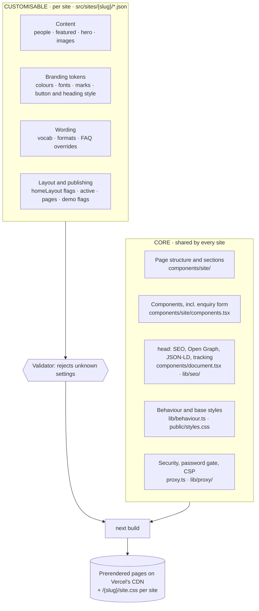
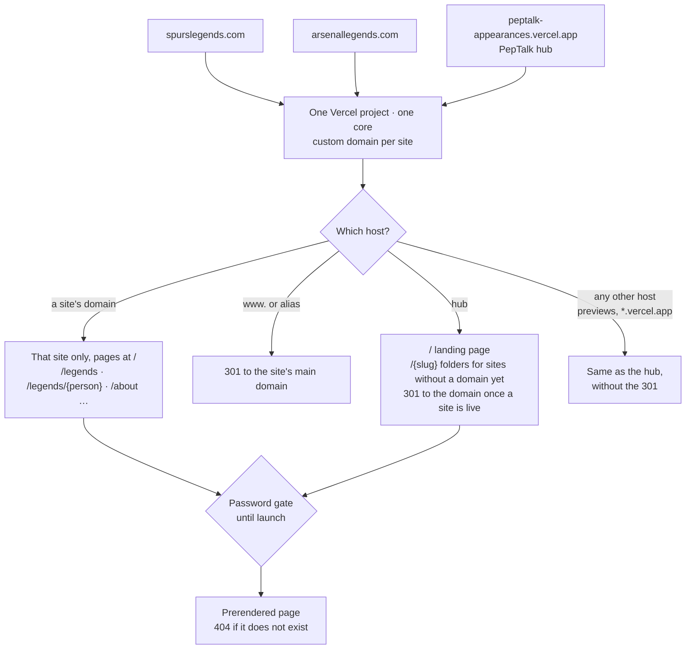

# Spurs Speaker Network

This repository is the **Spurs Speaker Network**, a Spurs-only spin-off of PepTalk Appearances: one real site (`src/sites/spurs/`), which is also the root site (`/` redirects to `/spurs`; the PepTalk landing page is at `/all`). The core still supports many sites; the tests use fictional partner sites (`test/fixtures/sites.mjs`) to prove the multi-site behaviour. Repository, deployment and hub references below describe the upstream PepTalk Appearances project until this one gets its own.

Repository: [getapeptalk/peptalk-appearances](https://github.com/getapeptalk/peptalk-appearances). Deployed app: [peptalk-appearances.vercel.app](https://peptalk-appearances.vercel.app/). The older demo at `appearances.getapeptalk.com` still runs on Railway; changes in this repository deploy to the Vercel app. See [deployment status](docs/deployment.md#current-demo-until-the-switch).

Official sports-talent booking sites for clubs, leagues and associations, operated by [PepTalk](https://www.getapeptalk.com). Each organisation gets its own branded site (here, `/spurs`). It lists former players, current stars, managers and staff who can be booked for keynotes, hospitality, brand work and community events.

**New to this repository? Start with [docs/onboarding.md](docs/onboarding.md):** setup, a 10-minute architecture tour, plugging in your CMS, the first deploy, launch checklists and open decisions.

> **Status: concept and partner demo.**
> - Content is hardcoded.
> - Photos are Getty Images *watermarked comps*, and partner marks are hotlinked.
> - The hub enquiry form prepares an email draft to `hello@getapeptalk.com`; visitors send it from their email app. Site-specific enquiry forms send nothing unless `ENQUIRY_WEBHOOK_URL` is set (unset by default; check the deployment's environment before testing).
> - No tracking is configured on any site.
> - Every site is password protected.
>
> Read [docs/brand-and-legal.md](docs/brand-and-legal.md) before anything goes public.

## Quick start

Requires Node 24 (see `.nvmrc`). The site is a Next.js app (App Router) deployed on Vercel; [docs/nextjs-migration.md](docs/nextjs-migration.md) records how it replaced the original static generator.

```bash
npm ci
npm run dev          # Next.js dev server on http://localhost:3000
npm run check        # lint + content validation + contract check + doc links + tests + typecheck: run before every PR
npm run build        # next build (what Vercel runs); then `npm start` serves it
npm run admin        # content admin on http://127.0.0.1:3095 (see docs/admin.md)
```

With no passwords set locally, every page is open. `/` redirects to `/spurs` (the root site, `registry.json → rootSite`) and the PepTalk landing page is at `/all`; without a root site, `/` is the landing page and `/all` answers `301` to `/`. [`/_gallery`](#component-gallery) shows every shared component in each site's branding. `npm start` runs in production mode, so it needs `PREVIEW_PASSWORD` (or `PREVIEW_PUBLIC=true`); without one it answers 503.

Next.js and the admin read `.env` if it exists; copy `.env.example` to start.

## Landing-page discovery and enquiries

The hub introduces six featured people before the sport collections, with name/topic search, organisation filters, expandable role-specific roster links, event formats, the booking process and practical FAQs. Editorial picks and photo focal points live in `src/copy/landing.mjs`; missing picks fall back to available featured people without repeating a person.

The hub form validates a brief and prepares an email draft addressed to `hello@getapeptalk.com`. Visitors must open and send the draft from their email app; the page never claims delivery, sends a network request or stores the details. Editing preserves the brief for the current page session. With JavaScript off, an email link is provided. Long briefs use a copyable full-text fallback and a short email link to avoid URL-handler truncation. Site-specific `/api/enquiry` forwarding is unchanged.

The hub uses the parent brand’s Recoleta Medium and Sofia typography. Refresh its share card with `npm run og-cards -- --landing-only` after editing the headline.

## How it works

```
src/sites/<slug>/        content as JSON: site.json (brand, wording, layout, switches), people.json, images.json
src/sites/registry.json  site order, the optional root site, old-slug redirects and per-site domains
src/copy/defaults.mjs    default wording, booking formats and FAQ (sites override per key)
app/, components/        Next.js routes and the shared React Server Components (one set for every site)
components/gallery/      the component gallery (/_gallery): every component in each site's branding, master password only
lib/content/             content layer: types, providers (JSON, in-memory, CMS seam, Airtable people sync), switches, contract, cache tags
lib/proxy/, proxy.ts     host routing (per-site domains), password gate, redirects, security headers, CSP, cache headers
lib/domains.ts           per-site domains: validation, hosts, the domain mount, canonical URLs
lib/enquiry/             POST /api/enquiry: partner-site form rules, forwarding to ENQUIRY_WEBHOOK_URL
lib/revalidate/          POST /api/revalidate: the CMS and Airtable webhook (REVALIDATE_SECRET), cache tags
lib/tracking.ts          the tracking slot (GTM/GA4, consent), off by default
lib/seo/                 titles and descriptions, structured data, sitemaps, robots.txt, llms.txt, the indexing switch
src/copy/legal/          Terms and Privacy Policy (markdown, shared by every site; placeholder text)
src/admin/               local content admin: manage sites, switch pages on or off, edit the JSON through forms
scripts/                 content validator, site scaffolding and packs, Open Graph cards, visual and performance checks
test/                    admin, content-rule and site-pack suites; test/next/ for the app (proxy, render, SEO, integration)
public/                  shared CSS, fonts, PepTalk logo, Open Graph cards (public/og/)
```

Every site shares one core: the same page structure, form, `<head>` and tracking, behaviour and security. Sites differ only in content, branding tokens and wording, so a core change rolls out to all of them at once (see [Core vs site](docs/architecture.md#core-vs-site)). The Next.js app prerenders every page at build time from the content provider (the JSON files by default), through one shared set of components. [docs/architecture.md](docs/architecture.md) and [docs/nextjs-migration.md](docs/nextjs-migration.md) cover the details and the reasoning.

## Architecture at a glance

### Core vs customisable

Every site is the same core with different data poured in. The core is shared code, changed once for all sites. The customisable layer is per-site JSON, edited by hand or in the admin.



| | Core (change once, every site gets it) | Customisable (per site) |
|---|---|---|
| Page structure and section order | Yes | Only through layout flags (`waysAfterRoles`, `hideEras`) |
| Enquiry form fields and behaviour | Yes | Option labels and wording only |
| `<head>`, SEO tags, tracking | Yes | Values only (`tracking: { gtmId, ga4Id }`, `consent.required`) |
| Domain | Host routing, canonical URLs, the gate per host | `registry.json → domains` |
| Look and feel | Base CSS and components | Colour, font and shape tokens, logos |
| Which pages exist | Page types | Switch optional pages off; hide people |
| Copy | Defaults | Any wording key, formats, FAQ answers |

Rules and how to add a new setting: [docs/architecture.md → Core vs site](docs/architecture.md#core-vs-site).

### Domains and pages

**One domain per site**, all served by one Vercel project and one core, is built: a site gets its own domain through `registry.json → domains`. **Today** no site has one, so every site is a folder on the Vercel hub at `peptalk-appearances.vercel.app`; the older `appearances.getapeptalk.com` hostname remains on Railway until its DNS switch. The model, per-host behaviour and the DNS runbook are in [docs/domains.md](docs/domains.md).



Every request also passes through:
- `/health`: status, no password needed
- `/og/*.jpg`: link-preview cards, public (on a site's domain, only that site's)
- old slugs: `301` to the new one (`registry.json → redirects`)
- `POST /api/enquiry`: the partner-site enquiry endpoint (forwards to `ENQUIRY_WEBHOOK_URL` when set)
- `POST /api/revalidate`: the CMS and Airtable webhook that refreshes pages without a deploy (authenticated by `REVALIDATE_SECRET`, outside the password gate)

Pages for each site. On the hub they sit under the site folder (`/spurs/legends`); on the site's own domain the same pages sit at the root (`/legends`).

| Path (hub: `/<slug>` prefix) | Page | Can be switched off |
|---|---|---|
| `/` | Home | No |
| `/legends` | Roster with role, era and search filters | No |
| `/legends/<person>` | Profile | Hide the person (`"active": false`) |
| `/ways-to-book` | Booking formats | `pages.waysToBook` |
| `/hospitality` | Hospitality | `pages.hospitality` |
| `/about` | About and FAQ | `pages.about` |
| `/check-availability` | Enquiry form | No |
| `/terms` | Terms (shared text, the site's branding; placeholder until launch) | No |
| `/privacy` | Privacy Policy (shared text, the site's branding; placeholder until launch) | No |
| `/site.css` | That site's theme | (automatic) |
| `/sitemap.xml`, `/llms.txt` | That site's sitemap and llms.txt: empty and 404 until the site is `indexable` (served by the canonical copy: the domain once live) | (automatic) |
| `/robots.txt` (own domain only) | That domain's robots.txt: allows everything once the site is indexable and the domain live | (automatic) |
| `/` (hub only) | PepTalk landing page listing every active site (master password only; a per-site password is sent to its own site). `/all` answers `301` to `/`. With `registry.json → rootSite` set, `/` redirects to that site instead and the landing page stays at `/all` | (automatic) |
| `/terms`, `/privacy` (hub only) | The same legal text in PepTalk branding, linked from the landing page footer | No |
| `/robots.txt`, `/sitemap.xml`, `/llms.txt` (hub only) | Crawler files that follow the indexing switch: disallow everything, empty index and 404 while nothing is indexable | (automatic) |
| `/_gallery`, `/_gallery/<slug>` (hub only) | The [component gallery](#component-gallery): master password only, never indexed, in no sitemap | (automatic) |

How URLs and domains behave:
- **Inactive sites** (`"active": false`) aren't built, so every URL under them returns 404 and they drop off the landing page.
- **Switched-off pages** aren't built, and every link to them is removed.
- **Canonical and Open Graph URLs** use the site's domain once it is `live`, otherwise the hub's origin: `PUBLIC_ORIGIN` when set, else `https://$VERCEL_PROJECT_PRODUCTION_URL` (never a partner domain), else the hub. Pages are prerendered, so origins are fixed at build time, never taken from the request.
- **Search engines** see `noindex` and a `robots.txt` that disallows everything, until a site is launched with `site.json → "indexable": true`. That flag also opens the site's sitemap and `llms.txt` and lifts its password ([content-model.md → Indexing](docs/content-model.md#indexing-the-launch-switch), [launch checklist](docs/brand-and-legal.md#launch-seo-checklist)).
- **Renaming a site** is a folder rename plus a `registry.json → redirects` entry. Old page and card URLs then 301 to the new slug.
- **Own domains:** a site moves onto its own domain through `registry.json → domains` (`primary`, `aliases`, `live`). Its pages are then also served at the root of that domain, with links that have no slug prefix; aliases `301` to the primary; until `live`, the hub folder stays the canonical URL, and after it the folder answers `301` to the domain. On a partner domain `/` is that site's home: it never shows the landing page or another site. See [docs/domains.md](docs/domains.md).

## Component gallery

`/_gallery` lists the sites, and `/_gallery/<slug>` renders every shared component in `components/site/` with that site's real content and branding: header and nav, hero and finder, section heads and trust checks, the role list, how booking works, the PepTalk band, the FAQ block, the closing call to action, the help tile, person cards (normal, limited, demo), featured grid, squad, ways-to-book grid, the enquiry form (idle, error and sent), FAQ, profile hero, at a glance, booking card, timeline, profile formats, photo gallery, closing band, footer, a legal excerpt, the consent banner, the beyond panel, breadcrumbs and badges, with links to every full page. Use it while working on components; `npm run dev` serves it without a password.

It is a developer tool: only the master password opens it (never a per-site password, and with no master password in production it answers 404), a site's own domain never serves it, and it is always `noindex` and left out of sitemaps, `llms.txt` and the link checks. A new component in `components/site/` needs an entry in `components/gallery/entries.tsx`, or `test/next/gallery.test.ts` fails. Details: [docs/onboarding.md → Component gallery](docs/onboarding.md#component-gallery).

## Event Spaces

The home and ways-to-book pages carry a venue-hire promotion ("book a meeting or event space at the stadium"), enabled first for Spurs. Edit **Site settings → Event Spaces** to configure its copy, image, button and partner URL; an empty URL hides it. Venue enquiries stay on the partner’s site. See [configuration and outbound tracking](docs/content-model.md#event-spaces).

## Managing sites and pages

Everything is switched in the content, either through the admin or by hand:

| To… | Set |
|---|---|
| Take a whole site offline (its URLs 404, it leaves the landing page) | `site.json → "active": false` |
| Hide an optional page (ways to book, hospitality, about) | `site.json → "pages": { "hospitality": false }` |
| Hide a person | `"active": false` on that entry |
| Change where `/` goes | Leave `registry.json → rootSite` out for the landing page (the default), or set it to a slug to redirect `/` there (admin: **Make root**, on a site or on the landing page row) |
| Record that a picture or logo is licensed | Admin → **Licences** tab (writes `licences.json`). Missing approvals raise alerts but never block publishing; `npm run validate -- --strict-licences` is the launch gate. |
| Verify a page or profile before launch | Admin → **Verification** tab: a checklist per built page and profile (writes `verification.json`). Editing content marks its checklist "changed since verification". Alerts only; `npm run validate -- --strict` (licences + verification) is the full launch gate. |

The validator stops anything that would break a live page. For example, it rejects featuring a hidden person or deactivating the root site (when one is set).

## Scripts

| Command | What it does |
|---|---|
| `npm run dev` | Next.js dev server |
| `npm run build` | `next build` (Vercel runs this) |
| `npm start` | `next start` (serves the build) |
| `npm run typecheck` | `next typegen` + `tsc --noEmit` (strict) |
| `npm run visual` | Visual regression check: screenshots 37 representative pages at 1280 and 390 px and compares them with a local baseline (`-- --update` captures it; run that on `main` first). Needs Chrome; baseline in `.visual/baseline/`, diffs in `.visual/diff/`. |
| `npm run perf` | Page-load metrics (LCP, CLS, TBT, TTFB, bytes, requests) for home, roster and a profile on two sites, mobile and desktop (needs Chrome). `-- --offline` blocks third-party requests and stubs photos; `-- --budget <file>` checks the results. `node scripts/perf-load.mjs --origin <url>` measures server TTFB and throughput. |
| `npm run perf:budget` | The CI performance budgets: a network-free `perf` run checked against `scripts/perf-budgets.json` (LCP, CLS, JS bytes, first-party bytes, requests); exits 1 when over ([docs/architecture.md → Performance budgets](docs/architecture.md#performance-budgets)) |
| `npm run admin` | Local content admin (sites, pages, people, wording, theme, licences, verification) |
| `npm test` | Node's built-in test runner: admin, content-rule, site-pack and performance-budget suites (`test/*.test.mjs`), the app suites (`test/next/*.test.ts`, the component gallery's included; the integration suite builds into `.next-test` and `.next-test-fixture`) and the content contract and provider conformance suites (`test/contract/*.test.ts`) |
| `npm run lint` / `npm run format` | Biome check / auto-fix |
| `npm run validate` | Check every site's content: references, images, colours, wording keys, switches, stray review notes |
| `npm run schema` | Regenerate the content contract (`schema/*.schema.json`, the field reference in `docs/content-contract.md`); `-- --check` fails when they're stale |
| `npm run contract` | The provider conformance suite against the providers the environment selects, e.g. your CMS or Airtable base ([content-contract.md](docs/content-contract.md#conformance-suite)) |
| `npm run airtable:dry-run -- --file <export.csv\|json> [--site <slug>]` | Map an Airtable export offline and diff it against the current people ([airtable-cms.md](docs/airtable-cms.md)) |
| `npm run docs:links` | Every relative link and anchor in the markdown files resolves |
| `npm run check` | lint + validate + schema check + doc links + test + typecheck. CI runs these and `next build`, and the performance budgets in a separate job. |
| `npm run new-site -- …` | Scaffold a branded **shell** site with placeholder people |
| `npm run assemble-site -- …` | Turn research output into a **populated** site |
| `npm run pack-site -- --slug <slug>` | Write `<slug>.site-pack.zip` for an existing site ([site packs](docs/site-packs.md)); `new-site` and `assemble-site` take `--pack` too |
| `npm run import-pack -- <file.zip>` | Import a site pack (inactive unless `--publish`; `--force` replaces an existing site) |
| `npm run og-cards` | Re-render the link-preview cards (needs Chrome; set `CHROME_PATH` if it isn't found) |

Run a single test file with `node --test test/next/proxy.test.ts`, or filter by name with `node --test --test-name-pattern="gate matrix" test/next/proxy.test.ts`. `NEXT_TEST_SKIP_BUILD=1 node --test test/next/app.test.ts` reuses the integration suite's last builds. After a change to page markup or styles, compare with a baseline from `main` using `npm run visual`.

## Adding a club, league or association

There are two paths, both covered step by step in [docs/adding-a-site.md](docs/adding-a-site.md):

- **Shell:** real brand, placeholder people and photos, for a first look with a partner. Use the admin's "New site" form or `npm run new-site`.
- **Populated:** research agents gather the brand, legends and current stars with Getty images. Then `assemble-site` writes and validates the site.

### The `/new-appearances-site` skill

An AI agent can build a whole site, end to end, with the skill in `.claude/commands/new-appearances-site.md`. Claude Code runs it as a slash command. Codex and other agents find it through `AGENTS.md` and follow the file directly.

```text
/new-appearances-site "Manchester United" --shell
/new-appearances-site "Wimbledon" --populated --root
/new-appearances-site "Wimbledon" --shell --pack      # no commit: produces wimbledon.site-pack.zip to upload in the admin
```

| Mode | What the agent does | Typical time |
|---|---|---|
| `--shell` (default) | Reads the organisation's website for colours, marks, button and heading style, and copyright line, and checks the marks load cross-site. Runs `new-site`, then adjusts wording, roles and eras to the sport. | Under an hour |
| `--populated` | Starts research agents in parallel, briefed with [docs/research-brief.md](docs/research-brief.md). One covers brand, config and 15+ current players verified on the official roster; others cover about 30 legends. Then runs `assemble-site`. | Half a day, mostly unattended |

`--root` makes `/` redirect to the new site (instead of serving the landing page). `--pack` makes the agent finish with a **site pack** (`<slug>.site-pack.zip`) instead of a PR: a human uploads it in the admin (Sites → **Upload a site pack**), reviews and previews it, and imports it (inactive). See [docs/site-packs.md](docs/site-packs.md).

In both modes the agent then:
1. builds and screenshots the home page, roster and two profiles at desktop and mobile width, and checks faces, marks and wording
2. renders the link-preview cards and runs `npm run check`
3. opens a PR on a `content/<slug>-site` branch, with the screenshots and a **verify list**: facts to confirm, current jobs, naming conflicts, people left out and why, and image concerns
4. reports the URL, people counts by role, what is still placeholder, and what needs the organisation (master marks, naming sign-off, image rights)

The skill never commits review notes into content (the validator rejects them) and never pushes to `main`. A new site can stay offline until the partner is ready, with `"active": false`.

Afterwards, a human finishes the job in the admin: tick licences and work through the verification checklists before launch.

## Configuration

| Variable | Purpose |
|---|---|
| `PREVIEW_PASSWORD` | Master password (HTTP Basic, any username). Opens every site, the landing page and the component gallery (`/_gallery`); nothing else opens those two. **Required when `NODE_ENV=production`** (every Vercel deployment, previews included) unless `PREVIEW_PUBLIC=true`; without it the app answers 503. |
| `PREVIEW_PASSWORD_<SLUG>` | Optional per-site password that opens only that site, e.g. `PREVIEW_PASSWORD_SPURS`. Hyphens in a slug become underscores. It never opens the landing page: its holder is redirected from there to their own site. |
| `PREVIEW_PUBLIC` | `true` turns the password gate off in production. Pages still send `noindex` and `robots.txt` still disallows everything, so this is not a launch switch (that's `site.json → indexable`). |
| `PUBLIC_ORIGIN` | The hub's origin for canonical, Open Graph, sitemap and structured-data URLs, read at build time. If unset: `https://$VERCEL_PROJECT_PRODUCTION_URL` (never a partner domain), else `https://appearances.getapeptalk.com`. Sites with a live domain use that instead. |
| `HUB_HOST` | The hub's host, where a live site's folder answers `301` to its domain. Default: `PUBLIC_ORIGIN`'s host, else `appearances.getapeptalk.com`. |
| `ENQUIRY_WEBHOOK_URL`, `ENQUIRY_WEBHOOK_SECRET` | Where the enquiry endpoint forwards enquiries (JSON, with the secret in `X-Enquiry-Secret`). Unset: enquiries are checked and discarded, nothing sent or stored. Redeploy after changing. |
| `TRACKING_GTM_ID` | Global Google Tag Manager fallback for sites without `site.json → tracking` (off by default; consent per `site.json → consent`). |
| `SEARCH_INDEXING` | `off` switches search indexing off everywhere, whatever `site.json → indexable` says (kill switch). Vercel preview deployments never index. |
| `CONTENT_PROVIDER`, `PEOPLE_PROVIDER` | Content sources: `json` (default), `cms` (stub until implemented, see [docs/content-contract.md](docs/content-contract.md)), `airtable` for people ([docs/airtable-cms.md](docs/airtable-cms.md)) |
| `AIRTABLE_TOKEN`, `AIRTABLE_CONFIG` / `AIRTABLE_CONFIG_FILE` | Airtable people sync: personal access token (`data.records:read`) and the sync config ([config/airtable.example.json](config/airtable.example.json)) |
| `IMAGE_HOSTS_EXTRA` | Extra https image origins (your R2 bucket) allowed by `next/image` and the CSP |
| `REVALIDATE_SECRET` | Shared secret for `POST /api/revalidate`, the CMS and Airtable webhook ([content-contract.md → Revalidation](docs/content-contract.md#revalidation)) |
| `PORT` | Port for `npm run dev` / `npm start` (default 3000) |
| `CHROME_PATH` | Chrome or Chromium binary for `npm run og-cards`, `npm run visual` and `npm run perf` |
| `ADMIN_*`, `GITHUB_*` | Admin settings, see [docs/admin.md](docs/admin.md) |

See [.env.example](.env.example); every variable, its environments and whether it is read at build time: [docs/vercel.md](docs/vercel.md). Deployment is described in [docs/deployment.md](docs/deployment.md).

## Troubleshooting

| Symptom | Cause |
|---|---|
| `npm start`: "Could not find a production build" | Run `npm run build` first (or use `npm run dev`) |
| `npm start` answers 503 on every page | Production mode needs `PREVIEW_PASSWORD` (or `PREVIEW_PUBLIC=true`) |
| Unexpected password prompt locally | A `PREVIEW_PASSWORD*` variable is set in your shell or `.env` |
| `EADDRINUSE` | Port 3000 is taken; set `PORT` (e.g. `PORT=3001 npm run dev`) |
| A new page or person 404s under `npm start` | Pages are prerendered, so rebuild after content changes (`npm run dev` picks them up on restart) |
| `npm run visual`: "No baseline" | Capture one first on `main`: `npm run visual -- --update` |
| Photos or logos missing | They are hotlinked from Getty and partner CDNs, so you need internet access |
| `og-cards`, `visual` or `perf`: Chrome not found | Set `CHROME_PATH` |
| A partner domain shows the hub (the landing page, or a password prompt for it) instead of its site | The host isn't in `registry.json → domains` (or its site is inactive), or the deploy predates it: unknown hosts behave as the hub |
| A partner-site enquiry form shows the concept confirmation although `ENQUIRY_WEBHOOK_URL` is set | The form reads it at build time: redeploy |

`GET /health` needs no app password and returns `200 {"status":"ok","revision":"<sha>"}` (`"local"` without `VERCEL_GIT_COMMIT_SHA`). In production without `PREVIEW_PASSWORD` or `PREVIEW_PUBLIC=true`, the proxy returns `503 {"status":"misconfigured"}` instead. A healthy response proves the deployment is running; load a real page to check rendering, images and the password gate.

## Documentation

- [Onboarding](docs/onboarding.md): start here. Day one, an architecture tour, plugging in your CMS, Airtable, the first deploy, launch checklists, open decisions, glossary
- [Architecture](docs/architecture.md): modules, request flow, security model, the component gallery, design decisions
- [Next.js decisions](docs/nextjs-migration.md): why Next.js, the CSP, proxy, 404, behaviour and metadata decisions, what changes for visitors when the live demo switches
- [Adding a site](docs/adding-a-site.md): shell and populated workflows, manual edits, checklist
- [Content model](docs/content-model.md): every field in `site.json`, `people.json` and `images.json`, plus the wording keys
- [Content contract](docs/content-contract.md): the shapes every provider returns (JSON Schema in `schema/`), errors, images, the conformance suite, revalidation webhooks
- [Site packs](docs/site-packs.md): one-file sites built by the skill or another checkout, imported in the admin
- [Admin](docs/admin.md): the local content admin
- [Research brief](docs/research-brief.md): the instructions given to research agents
- [Deployment](docs/deployment.md): Vercel project, environment, switching the live demo over, rollback
- [Vercel](docs/vercel.md): project settings, every environment variable, previews, the enquiry webhook, the first deploy
- [Domains](docs/domains.md): one domain per site (implemented), per-host behaviour, DNS runbook
- [Brand and legal](docs/brand-and-legal.md): licences, marks, consent, launch checklist
- [Airtable profile sync](docs/airtable-cms.md): how to switch on people and R2 images from Airtable, dry run, webhooks
- [Contributing](CONTRIBUTING.md) and [Changelog](CHANGELOG.md)

## Licence

Proprietary. © PepTalk. Club, league and association marks belong to their owners; photographs belong to Getty Images or the credited rights holders.
