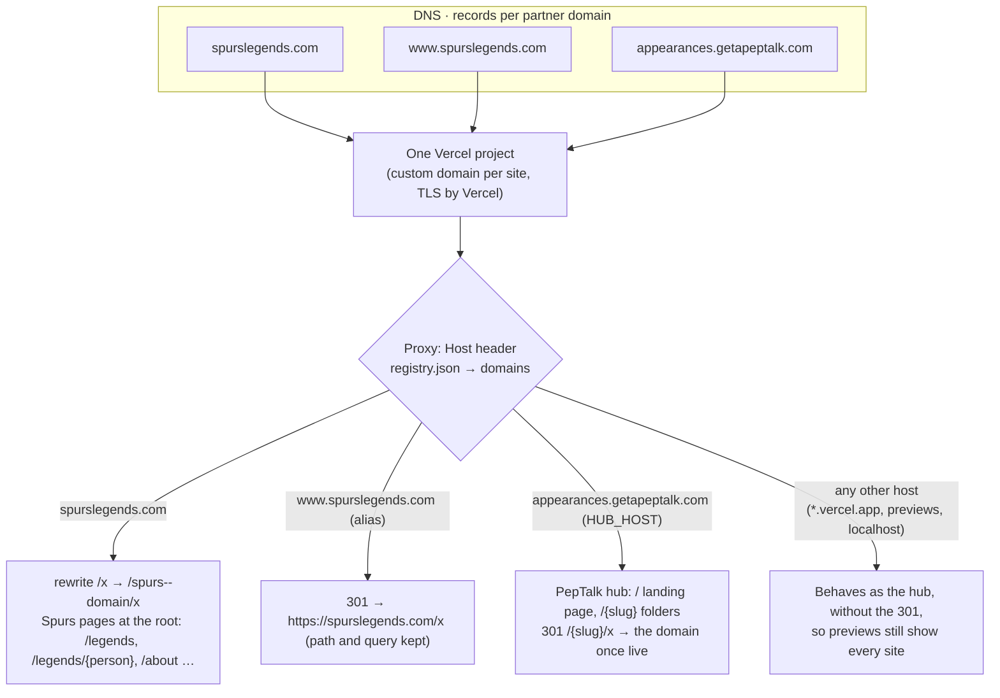

# Domains: one domain per site

> **Status: implemented.** Any site can be served from its own domain (for example `spurslegends.com`) by the same Vercel project and the same core, as data in `registry.json → domains`. No site has a domain configured yet, so today every site is still a folder on `appearances.getapeptalk.com` (`/spurs`). The runbook for pointing a domain is [below](#pointing-a-domain-runbook-per-site).

## How it works



- **Same core, different mount.** A site on its domain is the same pages with a different link prefix. Pages, the form, tracking and security stay core and change once for every site.
- **Pages at the root.** On its domain a site's pages drop the folder: `spurslegends.com/legends/sandro`, not `/spurs/legends/sandro`. Every link on those pages is domain-relative.
- **One canonical URL per page.** Until a domain is `live`, the hub folder is canonical and the domain copy is `noindex`. Once `live`, the domain is canonical, the folder answers `301` on the hub host, and canonical, Open Graph, structured data, sitemap and `llms.txt` URLs use the domain, on every copy.
- **Sites without a domain** keep working in folders on the hub, so a new pitch needs no DNS until the partner signs.

## Configuration

```json
{
  "order": ["spurs", "arsenal", "…"],
  "redirects": { "england": "thefa" },
  "domains": {
    "spurs":   { "primary": "spurslegends.com", "aliases": ["www.spurslegends.com"], "live": false },
    "arsenal": { "primary": "arsenallegends.com", "aliases": [], "live": false }
  }
}
```

| Field | Meaning |
|---|---|
| `primary` | The canonical host for the site: a lowercase hostname, no scheme, port, path or trailing dot |
| `aliases` | Extra hosts (e.g. `www.`) that answer `301` to `primary`, keeping path and query |
| `live` | `false` while DNS or TLS is being set up: the domain already serves the site (so it can be checked), but stays `noindex` with canonical URLs on the hub. `true`: hub folder URLs `301` to the domain, and the domain becomes canonical. |

Validator rules (`lib/domains.ts → domainProblems`, run by `npm run validate`, the admin and CI):
- hostnames must be valid lowercase names
- a host belongs to one site only (primaries and aliases together)
- no host can be the hub's host (`HUB_HOST`, else `PUBLIC_ORIGIN`'s host, else `appearances.getapeptalk.com`)
- every slug must be in `order`; no unknown keys

An inactive site's domain is dropped from the build, so its host answers like an unknown host.

## Host routing (the proxy)

`lib/proxy/decide.ts` reads the `Host` header (on Vercel it is the custom domain the visitor used, [request headers](https://vercel.com/docs/headers/request-headers)) and decides:

| Host | Behaviour |
|---|---|
| A site's `primary` | That site only. Page paths are rewritten to the site's **domain mount** (`/x` → `/<slug>--domain/x`), and so are its own files: `/site.css`, `/robots.txt`, `/sitemap.xml`, `/llms.txt`. Shared, partner-neutral assets pass as they are: `/styles.css`, `/fonts/*`, `/peptalk/*`, `/_next/*`, the site's own Open Graph cards and the generic one, `/health`, `/api/enquiry`. `/` is the site's home, never the landing page. Everything else (`/all`, `/arsenal`, `/spurs/legends`, another site's card, `/landing.css`) is a 404. |
| A site's alias | `301` to `https://<primary><path><query>`, except `POST /api/revalidate` (below) |
| The hub (`HUB_HOST`, default `appearances.getapeptalk.com`) | `/` is the PepTalk landing page (master password only) and `/all` answers `301` to it; with `registry.json → rootSite` set, `/` redirects (`302`) to that site instead and the landing page stays at `/all`. Then renamed slugs, folders and the gate. A **live** site's folder answers `301` to the same path on its domain (`/spurs/legends?x=1` → `https://spurslegends.com/legends?x=1`), and renamed slugs, the root-site redirect and the landing page's redirect for a site-password holder go straight there in one hop. |
| Any other host | Behaves as the hub, **without** the folder `301`. This covers Vercel preview and deployment URLs (`*.vercel.app`) and `localhost`, so a reviewer can still see a live site's pages on a preview before it is promoted. Vercel only routes hosts that are added to the project, so no stranger's domain reaches the app; deployment URLs carry Vercel's own `X-Robots-Tag: noindex` on previews ([Vercel](https://vercel.com/kb/guide/are-vercel-preview-deployment-indexed-by-search-engines)), and pages there keep their canonical URLs. |

Domain mounts (`/<slug>--domain/…`) answer 404 on every host except through their own domain. Slugs can't contain `--`, so a mount can never collide with a site.

Only the proxy reads `Host`, and only to route: pages stay prerendered and never see the request.

## Decision: a domain mount per site, prerendered (2026-10-20)

Pages are static (prerendered at build, served from the CDN; [architecture.md → Rendering and CSP](architecture.md#rendering-and-csp)), so a page can't learn its host at request time. Links on a site's own domain need no slug prefix, so the same page needs two prerendered copies: the folder copy (`base = /spurs`) and the domain copy (`base = ''`).

**How:** the `[site]` route segment takes two kinds of value: a slug (the folder copy) and `<slug>--domain` (the domain copy). `generateStaticParams` emits both for a site with a domain (`lib/pages/site-page.ts → siteSegments`), and `loadSite()` turns the segment back into the site plus the mount. Everything else is unchanged: the same routes, components and layout, with `SiteContext.base` (`''` on the domain) for links and `SiteContext.url()` for canonical URLs.

Alternatives rejected:
- **Dynamic rendering per host** would lose the CDN (every page view to the function region, cold starts), the reason pages are static.
- **Relative links** (`./legends`) break on nested pages and in the structured data.
- **A separate route tree per mount** (e.g. `app/(domain)/[site]/…`) duplicates every route file. One segment value does the same with no copied code.
- **The raw hostname as the segment** (`/spurslegends.com/legends`) puts dots in a path segment, which Next.js and Vercel treat as file extensions in places ([proxy docs](https://nextjs.org/docs/app/api-reference/file-conventions/proxy) matcher examples); `<slug>--domain` is a plain segment.

Cost: a site with a domain is prerendered twice (one page per person plus nine, per copy), so builds grow a little per domain.

## Per-host behaviour

| Concern | Folder copy (`/spurs/…`) | Domain copy (`spurslegends.com/…`) |
|---|---|---|
| Links | `/spurs/legends` | `/legends` |
| Stylesheet | `/spurs/site.css?v=…` | `/site.css?v=…` |
| Canonical, `og:url`, JSON-LD | the hub folder until `live`, then the domain | same |
| `<meta name="robots">`, `X-Robots-Tag` | indexable only if the site is `indexable` and the domain is **not** live | indexable only if the site is `indexable` and the domain **is** live |
| `robots.txt` | the hub's: `Allow` for indexable sites (so crawlers follow a live site's `301`s) | the domain's: `Allow: /` plus its sitemap once indexable and live; `Disallow: /` before |
| Sitemap | `/spurs/sitemap.xml`, listed in the hub's index, while the folder is canonical; empty once live | `/sitemap.xml`: the site's pages on the domain, once live |
| `llms.txt` | while the folder is canonical | once live; the hub's `/llms.txt` links to it |
| Password gate | the master or the site's password opens `/spurs/…` and shared assets | the master or the site's password opens everything on the host; no other password does. An indexable site is public on both. |
| Enquiry form | posts to `/api/enquiry`; back to `/spurs/check-availability#…` | posts to `/api/enquiry` on the domain; the proxy names the domain's site (`x-appearances-site`, never trusted from the client); back to `/check-availability#…` |
| Tracking CSP | the site's tags | the same |
| Revalidation webhook | `POST /api/revalidate`, outside the gate, authenticated by `REVALIDATE_SECRET` | the same on the domain and its aliases (never `301`, never rewritten into the mount). Revalidating `site:<slug>` refreshes both copies: the domain mount reads the same tagged cache entry as the folder ([content-contract.md → Tags](content-contract.md#tags)). |

The hub's own origin for canonical URLs comes from `PUBLIC_ORIGIN`. Its fallback, `VERCEL_PROJECT_PRODUCTION_URL`, is ["the shortest production custom domain"](https://vercel.com/docs/environment-variables/system-environment-variables), which can be a partner's domain once the project has several, so a partner host is never used for the hub (`lib/origin.ts`). Set `PUBLIC_ORIGIN` in Production.

Tests: `test/next/proxy.test.ts` (every routing case, the gate per host, POST, the tracking CSP), `test/next/domains.test.ts` (hosts, mounts, canonical URLs, per-mount rendering and discovery files) and `test/next/app.test.ts` (a fixture build with a live and a not-live domain, requested with real `Host` headers: prerendered mounts, links, 404s for other sites, aliases, the hub `301`, canonical per host, robots/sitemap/llms per host, the gate per host, the enquiry endpoint on a domain).

## Pointing a domain (runbook per site)

1. **Ownership.** PepTalk registers and owns the domain (the domain must stay with PepTalk, with a `301` to getapeptalk.com on termination). Agree the name with the partner first (see [Open questions](#open-questions)).
2. **Add it in Vercel.** Project → **Settings → Domains → Add**: add `spurslegends.com`; Vercel offers to add `www.spurslegends.com` too ([add a domain](https://vercel.com/docs/domains/working-with-domains/add-a-domain)). Don't set a Vercel domain redirect between them: the app's alias `301` does that, keeping path and query, and the registry stays the one source.
3. **DNS** (Cloudflare recommended). Create exactly the records the domain card in Vercel shows: it is the source of truth ([A records](https://vercel.com/kb/guide/a-record-and-caa-with-vercel)).
   - **Apex** (`spurslegends.com`): an `A` record to the IP on the card (`76.76.21.21` for most projects; newer projects get another anycast IP).
   - **`www`**: a `CNAME` to the project-specific target on the card (like `d1d4fc829fe7bc7c.vercel-dns-017.com`), not a generic one.
   - **Verification:** if the domain is used by another Vercel account or team, Vercel asks for a `TXT` record at `_vercel.spurslegends.com`; add it as shown.
   - Keep the records **DNS only** (grey cloud) while Vercel issues the certificate.
4. **Registry.** Add the domain with `"live": false`, run `npm run validate`, open a PR and deploy:
   ```json
   "domains": { "spurs": { "primary": "spurslegends.com", "aliases": ["www.spurslegends.com"], "live": false } }
   ```
5. **Verify** (the domain card shows "Valid Configuration" and a certificate):
   - `https://spurslegends.com/health` answers `{"status":"ok",…}` with the new commit.
   - `https://spurslegends.com/` shows the Spurs home behind the password; `PREVIEW_PASSWORD_SPURS` or the master password opens it, another site's password doesn't.
   - `https://www.spurslegends.com/legends?x=1` answers `301` to `https://spurslegends.com/legends?x=1`.
   - `/all`, `/arsenal` and `/spurs/legends` on the domain answer `404`.
   - The page source has `<link rel="canonical" href="https://appearances.getapeptalk.com/spurs/…">` and `noindex` (not live yet).
   - `curl -sI https://appearances.getapeptalk.com/spurs` still answers `200`/`401` (no move yet).
6. **Go live.** Set `"live": true`, PR, deploy. Then check:
   - `https://appearances.getapeptalk.com/spurs/legends` answers `301` to `https://spurslegends.com/legends`.
   - Canonical URLs on the domain are `https://spurslegends.com/…`.
   - At public launch, set `site.json → indexable` for that site only ([launch checklist](brand-and-legal.md#launch-seo-checklist)); then `https://spurslegends.com/robots.txt` allows crawling and lists `https://spurslegends.com/sitemap.xml`. Add the domain to Google Search Console and submit that sitemap.
7. **Roll back.** Set `"live": false` (folders stop moving and canonical URLs return to the hub) or remove the entry, and deploy. DNS can stay.

**Checking locally before DNS:** `npm run build && npm start`, then `curl -H 'Host: spurslegends.com' http://localhost:3000/legends`. Vercel preview URLs can't carry a partner host, so a preview shows the folder copy only.

## Open questions

- **Naming.** "Legends" names clash with some organisations' own programmes (see [brand-and-legal.md](brand-and-legal.md)). Agree each domain name with the partner before buying it.
- **The hub's future.** Does `appearances.getapeptalk.com` stay as the PepTalk hub (the landing page at `/`) for every partner? It should, because it's where link equity to getapeptalk.com is built. The landing page still links to sites by folder; for a live site that link answers `301` to the domain (its structured data already names the domain).
- **Partner subdomains.** Some partners may prefer a subdomain of their own site (`speakers.tottenhamhotspur.com`). That works the same way (a `CNAME` from their DNS), but the partner then controls the DNS. Contract terms should cover that.
